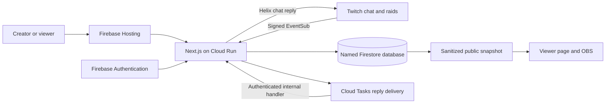

# Rallypoint

**Give every viewer a way in.** A participation desk for Twitch creators who run shared challenges, creative builds, and ongoing stories.

A viewer arrives halfway through a stream. The regulars know the goal, the stakes, and the running joke. Rallypoint gives the newcomer one clear next step: read the current brief, then take part in the current decision.

**App:** [rallypoint-desk.web.app](https://rallypoint-desk.web.app)
**Source:** [github.com/shi1720/rallypoint-live](https://github.com/shi1720/rallypoint-live)
**Demo:** [Watch the captioned product walkthrough](https://www.youtube.com/watch?v=CbFh_5jZIUE)

Created by Shivam Gupta with OpenAI Codex as an implementation collaborator. The runtime is deterministic. It does not need an OpenAI API key or continuous audio transcription.

## Try the app

- **Sample scenario:** open [/demo](https://rallypoint-desk.web.app/demo). All chat, raids, names, and metrics in this scenario are explicitly simulated. No account or Twitch credentials are needed.
- **Your own workspace:** open [/signin](https://rallypoint-desk.web.app/signin). Sign in with email/password or choose **Try a workspace** to create a real, private guest workspace. Guest access stays with that browser. Creating an account upgrades the guest UID so the same workspace can be used across devices.
- **Live Twitch:** the broadcaster must authorize a configured Twitch application. Live authorization and real Twitch traffic are separate from the sample scenario. See the setup below and the [verification record](docs/verification.md) for the observed release status.

A public viewer page is read-only. Publication, community review, export, and reset require the workspace owner's verified session.

## The workflow

| Surface          | Behavior                                                                                                                                                                    |
| ---------------- | --------------------------------------------------------------------------------------------------------------------------------------------------------------------------- |
| Creator desk     | Publish a goal, context, stakes, exact action, choices, and expiry. Editable templates cover a rescue, a collaborative build, and a tabletop decision.                      |
| Twitch chat      | `!catchup` returns approved context. `!join A` or `!join B` casts or changes one vote per viewer per chapter. `!vote` aliases `!join`.                                      |
| Community inbox  | `!pitch Your update` queues context with its source message ID. Accepting saves it for editing. Explicit publication is still required.                                     |
| Incoming raid    | A signed raid event opens a 90-second welcome beside the current approved brief.                                                                                            |
| Viewer page      | Shares current context and aggregate results. It never exposes participant identities or private pitches.                                                                   |
| OBS overlay      | A transparent browser source displays the brief and welcome. Closed, expired, disconnected, or stale invitations stop showing live commands.                                |
| Insights         | Counts explicit participation, approximate page opens, and actions during a raid welcome. These are not retention metrics or proof that a viewer arrived in the raid.       |
| Session controls | Export before a guarded reset. Starting a new session clears its history while retaining Twitch authorization and public links. Sign-out clears app access on that browser. |

Separate moderator accounts, paid subscriptions, creator traction, and causal retention results are not represented as implemented or validated.

## Architecture

The current app runs on **native Next.js 16 and Node.js 24.12+**. Firebase Hosting serves the clean URL and rewrites dynamic requests to Cloud Run. Firebase Authentication verifies email/password or anonymous identities. The server exchanges a fresh Firebase ID token for an HTTP-only `__session` cookie and verifies ownership on every private operation.

Cloud Firestore uses the named **`rallypoint`** database. Private session state is compressed and size-bounded so the documented 5,000-contribution session limit does not exceed Firestore's 1 MiB document limit. A separate public snapshot keeps viewer reads small and excludes private records. Firestore transactions commit state, delivery receipts, and reply outbox entries together. Stale publish, close, and reset confirmations fail instead of overwriting newer work.

Twitch webhooks authenticate the exact raw body with HMAC-SHA256. Delivery receipts and underlying chat-message IDs prevent duplicate processing. Signed event times stop delayed commands from entering a later chapter. Cloud Tasks delivers committed outbox work to a signed internal handler. Replies are rate-limited; ambiguous sends are not blindly retried because the Twitch chat endpoint does not offer an application idempotency key. A definitive chat authorization denial atomically pauses public invitations for that exact authorization. A newer reconnect or rotated token is protected from an older failed request.



The previous Sites/Cloudflare runtime and header-trusting identity helper have been removed. Client-supplied Sites identity headers cannot authenticate a Firebase workspace.

## Run locally

Use Node.js **24.12 or newer** and npm.

```sh
git clone https://github.com/shi1720/rallypoint-live.git
cd rallypoint-live
npm ci
npm run dev
```

Open `http://127.0.0.1:3000/demo` to explore the sample scenario. It runs the same pure state engine as the server and needs no cloud credentials.

A real local workspace needs a Firebase project, enabled email/password and anonymous Authentication, the named Firestore database, and Application Default Credentials with the relevant access. Configure ignored `.env.local` values before starting Next.js. Use a dedicated development project or database when experimenting.

| Server variable         | Purpose                                                                                                                    |
| ----------------------- | -------------------------------------------------------------------------------------------------------------------------- |
| `GOOGLE_CLOUD_PROJECT`  | Backing Google Cloud/Firebase project ID. This may differ from the Firebase Hosting site ID.                               |
| `FIRESTORE_DATABASE_ID` | Named database, normally `rallypoint`.                                                                                     |
| `FIREBASE_WEB_CONFIG`   | JSON web-app configuration containing public `apiKey`, `authDomain`, `projectId`, `appId`, and `messagingSenderId` values. |
| `SITE_URL`              | Exact canonical origin. Hosted release: `https://rallypoint-desk.web.app`. For local write tests, use the local origin.    |
| `TWITCH_CLIENT_ID`      | Registered Twitch application ID.                                                                                          |
| `TWITCH_CLIENT_SECRET`  | Confidential Twitch application secret.                                                                                    |
| `TWITCH_WEBHOOK_SECRET` | Random ASCII signing secret, 10 to 100 characters.                                                                         |
| `TOKEN_ENCRYPTION_KEY`  | 32 random bytes encoded as base64 for AES-GCM token encryption.                                                            |
| `CLOUD_TASKS_QUEUE`     | Reply-delivery queue name.                                                                                                 |
| `CLOUD_TASKS_LOCATION`  | Queue region.                                                                                                              |

Do not commit private keys, access tokens, session cookies, or populated environment files. Production uses the Cloud Run service account and Secret Manager, rather than a service-account key in the repository. Configure the canonical origin correctly: Firebase Hosting forwards to Cloud Run, so the internal request host can differ from the public origin.

Firebase Hosting forwards the `__session` cookie to dynamic backends. The app uses that cookie for authentication, binds OAuth state to the same server session, and uses a random browser identifier in the open-count request body instead of relying on an additional cookie.

## Connect Twitch

1. Sign into the [Twitch developer console](https://dev.twitch.tv/console/apps). Register a **confidential** application. Twitch may require a verified account and two-factor authentication.
2. Add this exact OAuth redirect: `https://rallypoint-desk.web.app/api/twitch/callback`.
3. Configure `TWITCH_CLIENT_ID` and `TWITCH_CLIENT_SECRET` through the production secrets mechanism. Preserve the encryption key while existing encrypted tokens remain in storage.
4. Open **Channel setup** in your signed-in workspace. Connect the broadcaster account and authorize the requested chat read/write and bot scopes.
5. Verify that the chat and incoming raid EventSub subscriptions are enabled. A saved authorization with pending subscriptions is not a confirmed live connection.
6. Publish a brief. In the connected channel, type `!catchup`, then `!join A`, then `!pitch Useful context for review`. Observe the actual reply, count, and inbox entry.
7. Accept or dismiss the pitch. Accepting does not publish it. Use the accepted text in the editor and explicitly publish the next brief.
8. Add the studio's overlay URL as an OBS **Browser Source**, set 1280 by 720, and keep the background transparent. Close the chapter and verify that the old command disappears from the public page and actual OBS source.

Rallypoint replies as the connected broadcaster in this release. Disconnect before switching Twitch accounts. Disconnect erases locally stored authorization and attempts remote subscription cleanup and token revocation. If cleanup cannot be confirmed, revoke the app through Twitch Connections as well.

## Deployment

The repository contains `Dockerfile`, `firebase.json`, and `firestore.rules`. The container builds native Next.js in standalone mode and runs as a non-root user. Firebase Hosting rewrites to the `rallypoint` Cloud Run service in `us-central1`. Firestore client rules deny direct database access; application operations use the server's authenticated administrative connection and owner checks.

The current release uses Google Cloud project `granted-ai-2026`, Hosting site `rallypoint-desk`, named database `rallypoint`, and Cloud Run service `rallypoint` in `us-central1`. These are existing deployment identifiers, not credentials.

```sh
python3 scripts/deploy-firebase.py --project granted-ai-2026 --site rallypoint-desk
```

The operator must already be authenticated and authorized for the project. For an independent deployment, supply a project and Hosting site that you control. Use the script and checked-in configuration together so the application, secrets references, and Hosting rewrite remain aligned. A backing Firebase project with billing enabled is needed for Cloud Run, even when traffic stays within free allowances. Use bounded Cloud Run instances and review infrastructure usage. Zero runtime model spend does not mean unlimited free hosting.

## Verify changes

```sh
npm test
npm run typecheck
npm run build
npm audit --omit=dev
```

The deployment suite is `tests/deployed-e2e.mjs`:

```sh
TEST_ORIGIN=https://rallypoint-desk.web.app node --experimental-strip-types tests/deployed-e2e.mjs
```

This is an **operator test**, not a normal user flow. It needs authenticated `gcloud` access to the designated test deployment, Firestore fixture access, and access to the webhook signing secret. It creates disposable Firebase users and isolated workspace fixtures, checks the real deployed API and transaction behavior, then removes its fixtures. It refuses unrelated origins. `npm run test:http` remains a compatibility entrypoint to the same current suite.

Signed fixtures are not real Twitch traffic. Follow the separate live Twitch steps before claiming live authorization, chat replies, or an actual OBS capture has been verified. See [testing instructions](docs/testing-instructions.md) for a no-credentials sample path and a normal signed-in workspace path.

## Limits and operations

- One Twitch channel per owner and one current decision per workspace.
- Up to 5,000 retained contributions, 100 pending pitches, 200 retained pitches, 50 raids, and 120 activity records per session. Storage encoding also enforces byte limits. Export and start a new session between streams.
- Viewer pages poll sequentially. They hide live commands on failed or stale refreshes. Actual channel readiness is distinct from having a brief published.
- Guest access is tied to the browser's Firebase identity. Clearing browser storage or signing out before upgrading can make that guest workspace inaccessible. Add an email/password account to keep access across devices.
- Operational receipts and outbox records use expiry fields. Deployed TTL configuration and Cloud Tasks retry settings determine cleanup/delivery behavior. Session content remains until the owner resets it.
- Ordinary chat and raw stream audio/video are not archived. Recognized commands, private review items, and bounded operational records are stored for the workflow. See [privacy](docs/privacy.md).
- Large-channel capacity, independent security certification, uptime guarantees, paid demand, and retention improvements have not been established.

## Project materials

- [Project story](docs/devpost-submission.md)
- [Testing instructions](docs/testing-instructions.md)
- [Verification record](docs/verification.md)
- [Commercial assumptions and validation plan](docs/business-plan.md)
- [Competitive research](docs/research.md)
- [Release checklist](docs/checklist.md)
- [Build record](docs/codex-build-log.md)

MIT license. Shivam Gupta supplied the product direction and commercial constraints. Codex assisted with implementation, reviews, tests, and documentation. Twitch and OpenAI names identify integrations and the development tool; they do not imply endorsement.
