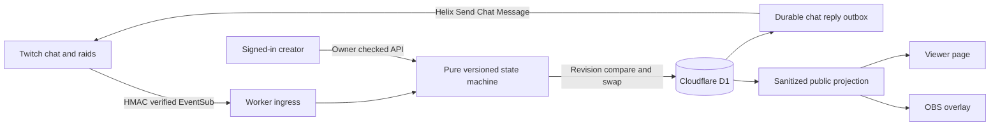

# Rallypoint

**Give every viewer a way in.** A live participation desk for Twitch communities, created by **Shivam Gupta with OpenAI Codex** for the Codex x TwitchCon Hackathon.

A new arrival needs more than a recap. Rallypoint gives them the current goal, why it matters, and one exact thing they can do in Twitch chat. A creator publishes one brief, and the chat response, viewer page and OBS overlay use the same version. Community pitches wait for review. Closing or expiring the chapter immediately ends the invitation.

- **Source:** https://github.com/shi1720/rallypoint-live
- **Hosted app:** https://rallypoint-live-shivam.sg127977958.chatgpt.site (initial deployment is owner-private; public judging access must be enabled before submission)
- **Interactive rehearsal:** append `/demo`. No Twitch keys required. All people, chat, raids and metrics there are simulated.
- **Live validation:** Twitch OAuth, Helix and EventSub code is implemented and tested with signed local fixtures. Real account authorization and real Twitch/OBS recording are still required. This is not a claim of a completed live Twitch test.

## Try it in five minutes

Requires **Node 22.16+** and npm. The repository includes original source, migration SQL, visuals, tests and submission materials.

```sh
git clone https://github.com/shi1720/rallypoint-live.git
cd rallypoint-live
npm ci
npm run build
npm run db:local
npm run dev
```

Open the printed local URL (normally `http://localhost:5173`). `/demo` works without credentials or a database. `/studio` uses the starter's clearly documented **development-only mock ChatGPT sign-in**. Click Sign in to create a local studio. Local mock authentication never ships in production builds. The mock account is shared by local preview tabs; do not run this development server on a public interface.

For local signed-webhook smoke tests only, copy `.dev.vars.example` to `.dev.vars`, restart the dev server, then run `npm run test:http`. This file contains an explicitly disposable test signing secret, not production credentials. The smoke test refuses non-loopback targets and inserts/removes its own test integration. It also publishes a disposable brief in the local development studio.

## What works

| Surface         | Behavior                                                                                                                                    |
| --------------- | ------------------------------------------------------------------------------------------------------------------------------------------- |
| Creator desk    | Create, edit, publish and close a versioned participation brief with 2 choices and a timed expiry                                           |
| Twitch chat     | `!catchup` returns approved context; `!join A` / `!join B` casts or changes one vote per viewer per chapter; `!vote` aliases `!join`        |
| Community inbox | `!pitch` queues an update with its chat-message receipt. Accepting saves it for editing. A separate publish action is always required       |
| Raid welcome    | Signed incoming `channel.raid` events display a 90-second welcome beside the current brief                                                  |
| Viewer page     | Read-only public context, current commands and anonymous results. No Twitch login needed to read once the site is public                    |
| OBS             | Transparent browser-source overlay, synchronized with the published brief. It stops displaying a stale action on expiry or close            |
| Insights        | Current contributions, contributions during a raid welcome, accepted pitches and approximate browser opens. These are not retention metrics |
| Export/reset    | Download the session as JSON, disconnect Twitch and start a fresh session                                                                   |

The broadcaster owns publication and review in this release. Separate moderator accounts and team permissions are future work, not shipped functionality. There is no automatic audio capture, generated summary, payment checkout or trained model. The core runtime makes **zero model API calls**.

## Twitch setup

Production needs an HTTPS public URL that Twitch can reach. The `/api/twitch/webhook` endpoint must not sit behind owner-only site access. The creator studio still requires sign-in even when the site is public.

1. Sign into https://dev.twitch.tv/console/apps and register a **confidential** application. Twitch may require verified email and two-factor authentication. Category: Application Integration (choose the closest applicable console category).
2. Add the exact OAuth redirect: `https://YOUR-ORIGIN/api/twitch/callback`. For this hosted app: `https://rallypoint-live-shivam.sg127977958.chatgpt.site/api/twitch/callback`.
3. Configure these **server runtime values** in Sites settings or your deployment's secrets manager. Do not commit them.

| Variable                | Value                                                                     |
| ----------------------- | ------------------------------------------------------------------------- |
| `TWITCH_CLIENT_ID`      | Registered Twitch client ID                                               |
| `TWITCH_CLIENT_SECRET`  | Registered confidential client secret                                     |
| `TWITCH_WEBHOOK_SECRET` | Random ASCII secret 10–100 characters; use 32 random bytes encoded as hex |
| `TOKEN_ENCRYPTION_KEY`  | 32 random bytes encoded as base64, used for AES-256-GCM                   |
| `SITE_URL`              | Exact production origin, without a path                                   |

Generate fresh application secrets locally with `node -e "console.log(require('crypto').randomBytes(32).toString('hex'))"` and `node -e "console.log(require('crypto').randomBytes(32).toString('base64'))"`. Treat the output as a secret. The initially registered Site already has generated encryption and webhook secrets configured; do not rotate them without a migration plan for existing tokens.

4. In `/studio`, open **Channel setup**, connect the broadcaster, and approve the scopes. Rallypoint requests `user:read:chat`, `user:write:chat`, `user:bot` and `channel:bot` for webhook-based chat. It acts and replies as the connected broadcaster; no separate bot account is required in this release.
5. Refresh connection status. Both `channel.chat.message` and incoming `channel.raid` subscriptions must become enabled. Retry event setup if Twitch could not verify the callback. Pending verification is not displayed as a successful connection.
6. Publish a brief, type `!catchup` and `!join A` in the actual connected channel, then verify the desk and viewer page update. Use `!pitch Your useful context here` and review it.
7. In OBS, add a **Browser Source**, paste your studio's private-to-your-session overlay link, set **1280 × 720**, and keep OBS's default transparent background CSS. Public overlay links are read-only and contain no API token. Treat a link as a shareable public publication of the approved brief.
8. Test close/expiry. Commands for the previous decision must stop working. Record this authentic sequence for the demo.

If changing broadcaster accounts, disconnect the first account before reconnecting. Disconnect erases local encrypted tokens and attempts remote subscription cleanup and token revocation. If Twitch is unavailable, revoke Rallypoint from Twitch Connections as well. Never paste tokens into the chat console or source code.

## Authentication and deployment

Production uses **Sites-managed ChatGPT sign-in** and its trusted identity headers, with D1 storage. Every studio mutation checks the authenticated owner. Twitch authorization connects a channel; it does not replace app login. Public routes return only approved content and aggregate participation counts.

This starter's `sites()` Vite integration is required for native Sites publishing. `.openai/hosting.json` declares `DB` and the Site project identity. Sites applies the committed schema migrations before uploading the Worker. Use the Sites workflow to build/package/deploy and preserve its authentication boundary. The bundled `npm start` is a built-Worker preview, not a standalone production identity provider. Deploying directly to another host requires a trusted authentication gateway and header protection; blindly trusting client-supplied identity headers is unsafe. “Free self-hosting” refers to the open-source software license, not a guarantee of free managed authentication or hosting.

## Verification

```sh
npm test                 # 59 engine and security tests
npm run typecheck
npm run build
npm run test:http        # dev server + migrated D1 + local fixture secret required
```

The HTTP suite checks authentication/CSRF, schema validation, concurrent stale editors against actual local D1, public privacy, export, signed Worker ingress, forged/old event rejection, duplicate deliveries and delayed raid timing. Test fixtures are not proof that Twitch account authorization works. See [verification](docs/verification.md) for the latest observed scope and limits.

## Architecture



`lib/rally/engine.ts` is shared by the rehearsal and real ingestion. The server never accepts simulated chat/raid actions through the owner API. Twitch webhook signatures cover the exact event ID, timestamp and raw body. A ten-minute acceptance window plus durable delivery receipts guards against replay. The underlying chat message ID provides an additional deduplication boundary. A revision check and D1 batch commit state, event receipt and optional outbox together. Conflicts retry with a fresh state and stale publish versions fail rather than overwrite.

Replies have per-viewer and five-second global cooldowns. Sending occurs after the event is durably committed. Pending replies can drain on redelivery; ambiguous sends are not automatically retried because Twitch's chat endpoint has no application idempotency key. Delivery failures need operator review. OAuth state is random, one-use, cookie-bound and expires after ten minutes. Access/refresh tokens are encrypted at rest with AES-GCM, validated periodically and refreshed server-side.

## Operational limits

- Intended initial segment: small and medium channels with recurring shared decisions. No large-channel load claim has been validated.
- One channel per studio, one active decision. No multi-tenant moderator roles yet.
- Up to 5,000 retained contributions per session, 100 pending pitches, 200 retained pitches, 50 raids and 120 activity records. Export/reset between sessions; the UI and engine reject capacity overflow. Past chapter counts are retained in export, not fabricated as new votes.
- Public pages poll every three seconds. Closing a brief reaches another page on the next successful poll; expiry also evaluates locally. A disconnected page must hide live commands when it cannot confirm freshness.
- “During raid welcome” means a command arrived during that time window. It does not identify raiders, establish a newcomer's first-ever chat message or prove retention.
- Browser opens are approximate counts limited by a browser cookie. They are not unique people or an abuse-proof analytics metric.
- No raw stream audio or full ordinary-chat archive. Recognized commands, pitches and contribution IDs are retained until export/reset, plus bounded replay metadata. See [privacy](docs/privacy.md).
- Hosting, database and Twitch service availability/rate limits still apply. Runtime model spend is zero, but infrastructure is not unlimited.

## Submission materials

- [Devpost copy](docs/devpost-submission.md)
- [Verbatim 2:45 video script and shot list](docs/script.md)
- [Business assumptions and validation plan](docs/business-plan.md)
- [Competitor research](docs/research.md)
- [Submission checklist](docs/checklist.md)
- [Independent rubric review](docs/judge-review.md)
- [Codex build log](docs/codex-build-log.md)

Shivam Gupta supplied the product ambition, commercial constraints and direction. Codex assisted with research, implementation, tests, design and documentation. Authorship and live validation are described accurately. Licensed under MIT. This project is independent of Twitch and OpenAI; their names identify integrations and the development tool.
